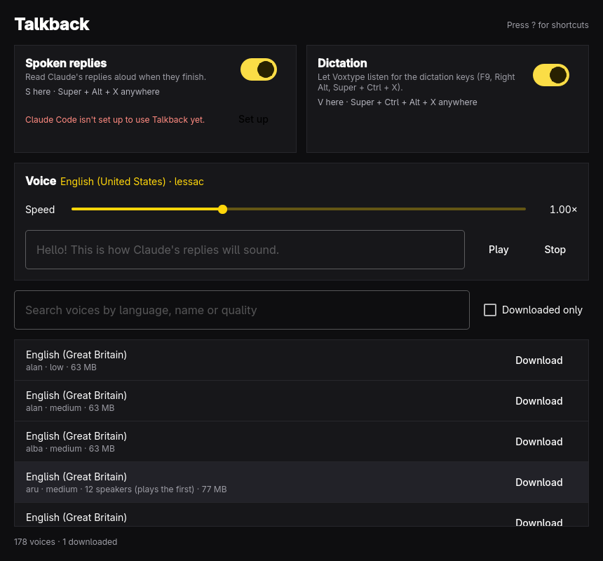

# Talkback



Talkback picks the [Piper](https://github.com/OHF-Voice/piper1-gpl) voice that
reads Claude Code's replies aloud, and turns spoken replies and Voxtype
dictation on and off. Browse every Piper voice, download one, hear it, and
make it the voice Claude speaks with.

It has three parts:

- **`talkback-speak`**, a Claude Code Stop hook that reads each finished reply
  aloud with Piper (skipping code blocks and tables) and plays previews.
- **`talkback`**, the window: the voice catalog, speed, and the two switches.
- **`talkback <command>`**, the same controls with no window, for keybindings.

Settings live in `~/.config/talkback/settings.conf` and voices in
`~/.local/share/piper-voices/`.

## Shortcuts

| Key | Action |
| --- | --- |
| `Space` | Play the selected voice |
| `Enter` | Use the selected voice, or download it |
| `D` | Download the selected voice |
| `Delete` | Remove the selected voice |
| `↑` `↓` | Move through the voices |
| `/` | Search voices |
| `I` | Show downloaded voices only |
| `+` `-` | Speak faster or slower |
| `S` | Turn spoken replies on or off |
| `V` | Turn dictation on or off |
| `Esc` | Stop speaking |
| `?` | Show every shortcut |
| `Q` | Quit |

## Commands

```text
talkback speech [on|off|toggle|status] [--notify]
talkback dictation [on|off|toggle|status] [--notify]
talkback voice [NAME]
talkback say TEXT
talkback stop
talkback hook install
talkback status [--json]
```

Dictation off stops Voxtype's user service, so the dictation keys do nothing
until it's turned back on or you log in again.

## Build and install

```sh
bin/build     # build/talkback
bin/test      # run the tests offscreen
bin/install   # makepkg -fsi, so Talkback shows up in the app launcher
talkback hook install
```

Needs `piper-tts` (AUR) and, for dictation, Voxtype set up under Omarchy's
Setup > Defaults > Dictation.

## Credits

The theme and language handling (`src/theme.cpp`, `src/translator.cpp`)
follow [Omacut](https://github.com/omacom-io/omacut) and
[Monologue](https://github.com/omacom/monologue), MIT licensed,
Copyright (c) David Heinemeier Hansson.

## License

MIT. See [LICENSE](LICENSE).
